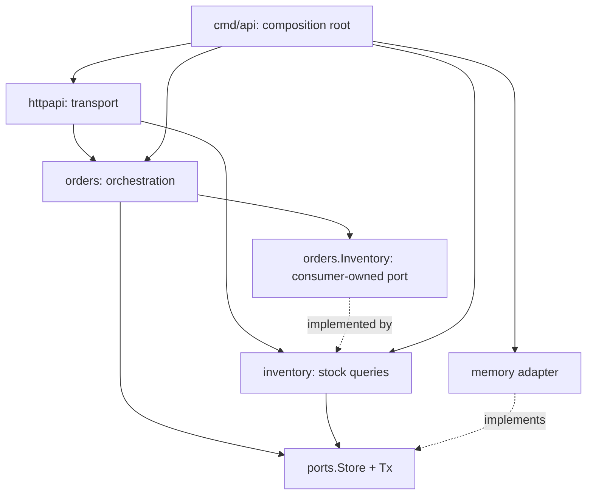

# Arsitektur

Modular monolith, satu proses dan satu batas transaksi. Pemisahan modul ditujukan untuk ownership dan pengujian; bukan microservices yang dipisahkan melalui HTTP.

`domain` berisi nilai bisnis dan error; `ports` mendefinisikan penyimpanan; `orders` memiliki interface inventory yang dikonsumsinya. `cmd/api` adalah satu tempat untuk memilih adapter dan menyusun aplikasi. Handler hanya melakukan parse, validasi transport, panggilan use case, dan mapping response.

## Alur create

1. Validasi key/customer/items; salin dan urutkan items berdasarkan SKU.
2. Hitung fingerprint payload canonical; mulai transaksi.
3. Periksa key. Jika sudah sukses: payload sama mengembalikan response awal; berbeda menghasilkan conflict.
4. Pastikan ID order baru tidak berbenturan; inventory memeriksa semua SKU sebelum mutasi.
5. Reservasi stok, simpan order, simpan response untuk key, commit bersama.

Adapter memory menjalankan callback pada salinan state di bawah mutex. Hanya callback sukses dengan context aktif yang menggantikan state committed. Semua getter/setter nilai dengan slice membuat salinan. Error atau panic tidak mengubah state committed.

## Alur cancel

Baca order di transaksi yang sama. Jika sudah cancelled, kembalikan tanpa mutasi. Jika reserved, release stok, ubah status/timestamp, lalu commit. `Inventory.Release` sendiri bukan operasi publik yang idempotent: idempotensi berasal dari state transition order yang atomik.

## Mengapa tidak dua transaksi terpisah?

Jika reserve sudah commit tetapi menyimpan order gagal, stok dapat hilang tanpa order. Jika cancel dan release terpisah, retry dapat menggandakan stok. Contoh ini mempertahankan satu transaction owner di use case order. Lihat ADR untuk konsekuensi jika dipecah menjadi service terpisah.

## Fondasi sprint selanjutnya

`internal/contracts/next.go` berisi port adjustment dan query order yang sudah konkret. Tidak ada stub sukses palsu atau endpoint placeholder. Memory state menyiapkan ledger adjustment dan mekanisme clone; hanya T02 menulis perilaku ledger tersebut.

Service, storage adapter, dan HTTP handler dapat dikembangkan paralel dengan test doubles yang memenuhi interface. T07/T08 kemudian menghubungkan implementasi asli; T09 mengaktifkan routes dan mempromosikan kontrak HTTP. File routing dan composition root dimiliki satu task sehingga enam worker awal tidak menulis file yang sama.

## Trade-off yang disengaja

- Semua transaksi, termasuk read, menyalin state: sederhana untuk demonstrasi, biaya bertambah dengan jumlah order/key.
- Tidak ada distributed transaction, outbox, retry otomatis, atau external dependency yang perlu disimulasikan.
- ID memakai random 128-bit; pengecekan collision menjaga invariant sebelum stok berubah.
- Logging JSON mencatat request ID, route template, method, status, durasi; body/customer/key tidak dicatat oleh request logger.
- JSON decoder standar menerima duplicate field dengan semantics last-value-wins; klien wajib mengirim nama field unik. Ini dicatat eksplisit di kontrak, bukan dianggap sebagai strict duplicate-key validation.
- Validator schema di tes HTTP sengaja terbatas pada keyword yang digunakan. Keyword unsupported menyebabkan tes gagal; ini bukan validator OpenAPI universal.
